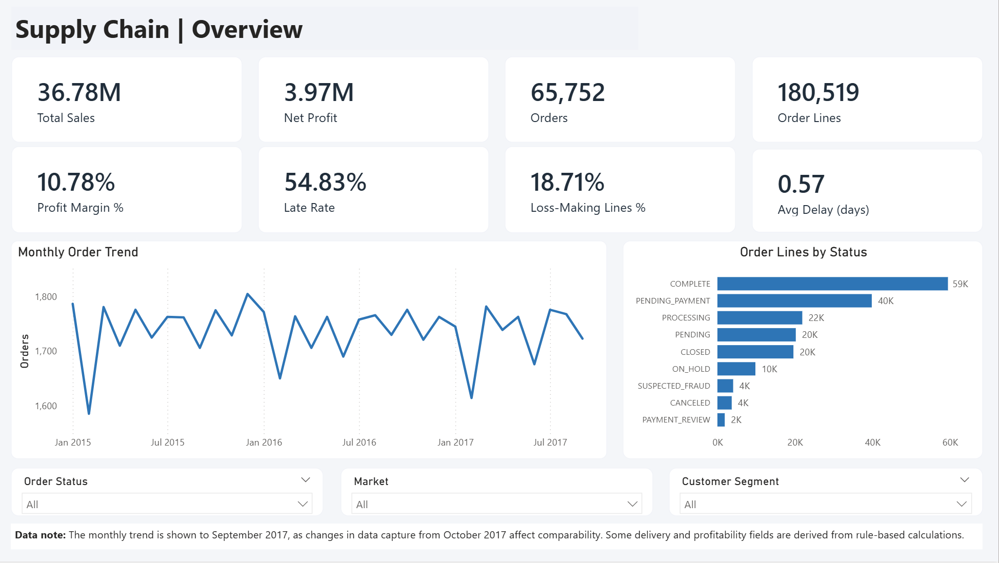
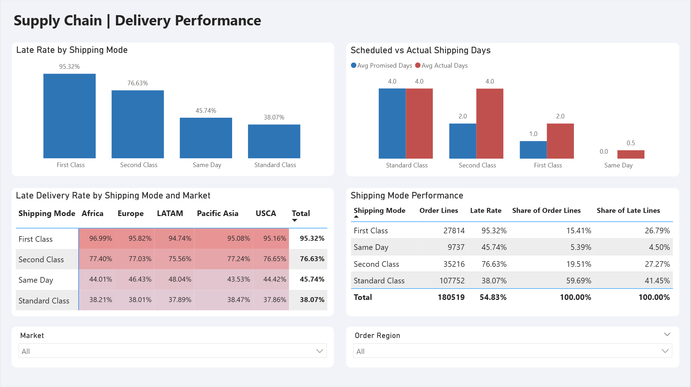
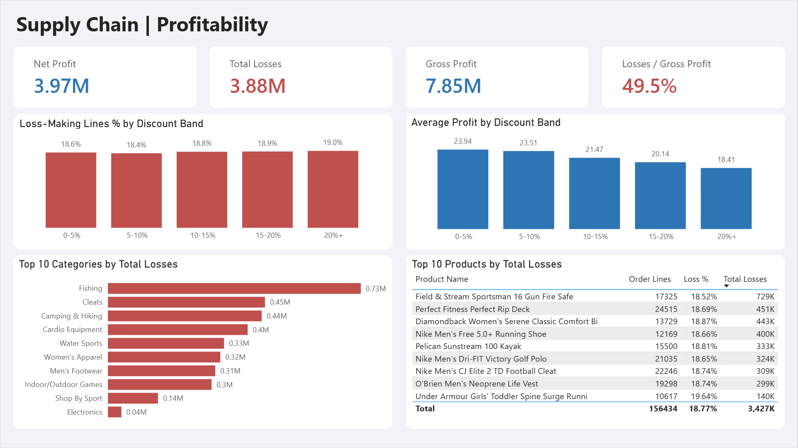
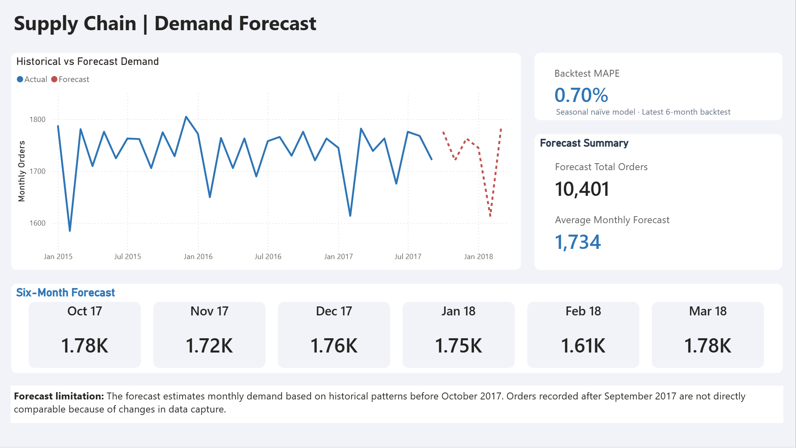

# DataCo Supply Chain Analytics

Where is this supply chain losing time and money, and what should order demand look like over the next six months? This project answers both using 180,519 order lines from the DataCo Smart Supply Chain dataset, with the analysis in Python and a four-page dashboard in Power BI.

## Dashboard

**Overview**


**Delivery performance**


**Profitability**


**Demand forecast**


## Key findings

- **Shipping mode drives lateness, not geography.** 54.8% of order lines arrive late. By mode the rate runs from 38.1% (Standard Class) to 95.3% (First Class), while markets sit in a narrow 54.4% to 55.2% band.
- **First Class is promised in 1 day but takes 2.** It's late by a consistent day on almost every order.
- **Second Class delivers no faster than Standard.** It's promised in 2 days but takes about 4, the same as Standard Class (4.0 days).
- **The premium tiers carry most of the lateness.** First and Second Class are about 35% of order lines but about 54% of late lines.
- **18.7% of order lines lose money.** Those losses total 3.88M and offset about 49% of the 7.85M earned on profitable lines, leaving a net margin of about 10.8%.
- **Losses are spread evenly.** The loss rate sits between roughly 18% and 20% across categories, products, discount bands, order statuses, shipping modes, segments and markets. The 76 lines losing more than 1,000 each make up only 2.9% of losses.
- **Deeper discounts don't make losses more frequent, but they cut profit per line.** Average profit falls from 23.9 to 18.4 (about 23%) between the lowest and highest discount bands.
- **Demand is steady and seasonal.** A same-month-last-year baseline forecasts monthly orders to within about 1% in backtests (0.7% on the latest six months) and expects an average of 1,734 orders a month for Oct 2017 to Mar 2018.
- **The data changes shape in October 2017.** From then on every order has a single line, so the forecast is trained and tested on Jan 2015 to Sep 2017 only.

## Recommendations

*If this were our data, this is what I'd do:*

- **Fix the First Class promise.** Reset it to 2 days to match what the network delivers, or fix the process behind it.
- **Review Second Class pricing.** It delivers in the same time as Standard, so check whether the premium is justified.
- **Add a minimum-margin check at order-line level**, starting with the handful of products that carry most of the volume.
- **Exclude cancelled and suspected-fraud orders from revenue reporting**, and keep order status as a filter on the dashboard.
- **Plan on the seasonal baseline**, and investigate the data feed behind the October 2017 change before forecasting any further.

## What's in this repo

```
dataco-supply-chain-analytics/
├── README.md
├── requirements.txt
├── .gitignore
├── data/
│   └── README.md                         where to download the dataset (the data itself isn't committed)
├── notebooks/
│   └── DataCo_Supply_Chain_Analysis.ipynb
├── output/                               summary tables exported by the notebook
└── dashboard/
    ├── DataCo_Supply_Chain.pbix
    └── screenshots/
```

## How to run it

1. Download the dataset (see [`data/README.md`](data/README.md)) and place `DataCoSupplyChainDataset.csv` in the `data/` folder.
2. Install the requirements:
```bash
   pip install -r requirements.txt
```
3. Open `notebooks/DataCo_Supply_Chain_Analysis.ipynb` in Jupyter or VS Code and run all cells. The results are saved to `output/`.
4. To open the dashboard, load `dashboard/DataCo_Supply_Chain.pbix` in Power BI Desktop. If the files can't be found, point the data sources at your local `output/` folder (**Transform data → Data source settings**).

## Approach

1. **Data quality:** checked for duplicates, bad dates and nulls, dropped two empty columns and removed personal fields.
2. **Exploratory analysis:** distributions, order mix, products, seasonality, correlations and outliers.
3. **Delivery performance:** late rate and promised vs actual days by shipping mode, market and region.
4. **Profitability:** where lines lose money, by discount band, category, product and segment.
5. **Demand and forecast:** a stability check, then a backtest of four models (seasonal naive, ETS, ARIMA and SARIMA) on two windows. The seasonal models all reached about 1% error, so I used the simplest, seasonal naive.
6. **Dashboard:** four Power BI pages built on the exported tables (overview, delivery performance, profitability and demand forecast).

### Power BI model

- **Tables:** cleaned order lines, a calendar table (related to order date), and a combined actual and forecast demand table.
- **Measures (DAX):** total sales, net profit, profit margin, late rate, share of late lines, loss-making lines %, total losses, gross profit, losses as a share of gross profit, and average promised, actual and delay days.
- **Transformations (Power Query):** date typing, column selection and appending actuals to the forecast.
- **Note:** the backtest error card on the forecast page is a fixed value taken from the notebook, not recalculated in Power BI.

## Tools and skills

- **Python:** pandas, matplotlib and statsmodels, covering data cleaning, EDA, forecasting and backtesting.
- **Power BI:** data modelling, DAX measures, Power Query and dashboard design.
- **Analysis:** data quality checks, trend and anomaly detection, forecasting, and turning findings into recommendations.

## Limitations

- **Several fields look rule-generated.** Each of the 18 discount levels is used on almost exactly the same number of lines, delays are fixed by shipping mode, lateness is identical across markets, and orders are flat across weekdays. The findings describe patterns in this dataset, not necessarily real-world customer or carrier behaviour.
- **The data changes in October 2017**, so the forecast uses 33 months and is backtested on only two short, overlapping windows.
- **The catalogue is thin.** Ten products make up 87.1% of order lines, so conclusions about categories are really conclusions about individual products.
- **There's no cost data**, so profit can't be explained from the available fields.
- **Totals include cancelled, suspected-fraud and pending orders**, which a finance team would normally treat separately.

## Data source

DataCo Smart Supply Chain for Big Data Analysis (Constante, Silva and Pereira), via [Kaggle](https://www.kaggle.com/datasets/shashwatwork/dataco-smart-supply-chain-for-big-data-analysis) and [Mendeley Data](https://data.mendeley.com/datasets/8gx2fvg2k6/5). See [`data/README.md`](data/README.md) for details.